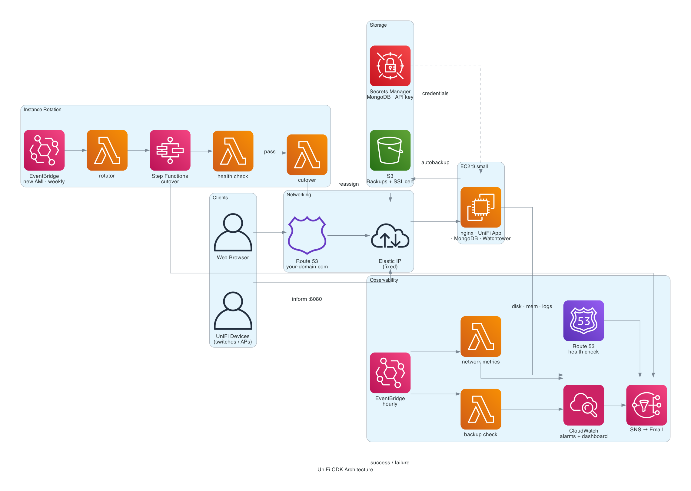

# unifi-cdk

A CDK TypeScript project that runs a self-hosted [UniFi Network Application](https://hub.docker.com/r/linuxserver/unifi-network-application) on AWS EC2 with fully automated instance rotation, backup/restore, SSL certificate management, and observability.

## Architecture



> To regenerate: `python3 docs/architecture.py` (requires `pip install diagrams` and `brew install graphviz`)

## What it does

### The basic setup

The UniFi controller runs in Docker on a single EC2 instance (t3.small) behind an nginx reverse proxy. A Let's Encrypt SSL certificate is issued via DNS-01 challenge against Route 53, making the controller reachable at a custom domain over HTTPS. A fixed Elastic IP address means the domain never needs updating when the instance is replaced.

### Automated instance rotation

Rather than patching the running instance, the system replaces it entirely whenever a new Amazon Linux 2023 AMI is published. Two things can trigger a rotation:

1. **New AMI** — EventBridge detects when AWS publishes an updated AL2023 AMI and immediately kicks off a replacement
2. **30-day ceiling** — a weekly Lambda check rotates the instance if it hasn't been replaced in the past 30 days, regardless of AMI updates

The rotation flow, orchestrated by AWS Step Functions:

1. A new EC2 instance boots alongside the existing one — your network keeps running on the old one
2. The new instance restores the SSL certificate from S3 (avoiding Let's Encrypt rate limits), downloads the latest UniFi backup, and restores it via the two-step UniFi API
3. After restore, all devices across all sites are force-provisioned via the UniFi API so they come back online immediately
4. Step Functions polls until the new instance passes health checks: EC2 status 2/2, UniFi ports open, and the controller showing the login page (not the setup wizard)
5. The Elastic IP is atomically moved to the new instance — your devices see no IP change
6. The old instance is terminated

If health checks never pass, the new instance is terminated and the old one keeps running. You get an email either way.

### Backup pipeline

- UniFi's built-in autobackup runs on a schedule and saves `.unf` files to `/opt/unifi/config/data/backup/autobackup/`
- An hourly cron syncs those files to S3 (`unifi-backups-<account-id>/backups/`)
- On each new instance, the latest backup is restored automatically
- The SSL certificate is cached in S3 (`unifi-backups-<account-id>/letsencrypt/`) and restored on boot to avoid Let's Encrypt's 5 certs/week rate limit

## Infrastructure

| Resource | Details |
|---|---|
| EC2 | t3.small, AL2023, gp3 30GB + 2GB swap |
| Docker | UniFi Network Application, MongoDB 4.4, Watchtower, nginx |
| Elastic IP | Fixed public IP, re-associated on each rotation |
| S3 | Backups + cached SSL cert, 30-day lifecycle expiry |
| Step Functions | Orchestrates boot wait → health checks → cutover |
| Lambda | 7 functions: health check, cutover, cleanup, rotation trigger, scheduled rotation check, backup freshness check, network metrics |
| EventBridge | New AMI trigger, weekly rotation check, hourly backup check, hourly network metrics |
| SNS | Email alerts for cutover success/failure and all CloudWatch alarms |
| CloudWatch | Disk, memory, backup freshness, network metrics; dashboard; anomaly detection |
| Route 53 | A record + HTTPS health check polling from multiple AWS locations |
| Secrets Manager | MongoDB password (auto-generated), UniFi API key |
| Log archive | S3 bucket for controller and device logs, Glue table, Athena workgroup and saved queries (see [Log archive](#log-archive)) |

## Observability

Alerts (via SNS email) fire when:
- Instance rotation succeeds or fails
- Disk usage exceeds 80%
- Memory usage exceeds 85%
- Your domain fails Route 53 health checks for 3 consecutive minutes
- No backup in S3 newer than 25 hours
- Estimated monthly AWS cost exceeds $25
- AWS Cost Anomaly Detection flags an unusual spend spike

The CloudWatch dashboard (`unifi-controller`) shows disk usage, memory usage, Route 53 health check status, backup freshness, and per-site connected client counts and WAN throughput across all three sites.

## Log archive

Controller and device logs go to S3 as gzipped JSON lines, and saved Athena queries answer questions about outages and device events. You query with SQL; you never need to read raw log files.

```
UniFi gateway, APs, switches ──syslog UDP 5514──▶ Raspberry Pi (Home Assistant add-on, Fluent Bit)
                                                        │ buffers on disk while offline
                                                        ▼
UniFi controller (EC2) ── Fluent Bit tails server.log ─▶ s3://unifi-logs-<account>/unifi/<source>/year=/month=/day=/
                                                        │
                                                        ▼
                                  Glue table + log_events view ─▶ Athena saved queries (workgroup unifi-logs)
```

| Piece | Where |
|---|---|
| Bucket, Glue table and view, Athena workgroup, saved queries, IAM user | `lib/constructs/logs.ts` |
| Match patterns (what counts as WAN down, device disconnect, …) | `lib/athena/log-events-view.sql` |
| Saved queries | `lib/athena/queries/*.sql` |
| Controller Fluent Bit setup | `lib/scripts/fluent-bit/` |
| Home Assistant add-on (not deployed by CDK) | `collector/unifi_log_shipper/` |
| Parser and Lua script shared by both | `collector/unifi_log_shipper/rootfs/etc/fluent-bit/` |

Every line has the same fields: `timestamp` (ISO 8601, UTC), `source` (`controller` or `devices`), `host` (sender IP, or the controller's domain), `hostname`, `program`, `severity`, `message`, and for device lines `raw` (the original syslog line). Partitions are UTC days, based on when Fluent Bit received the line.

### Deploying

A normal deploy creates everything. Two optional settings:

```bash
npx cdk deploy --context logRetentionDays=730 --context athenaBytesScannedLimitGb=1
```

Stack outputs give you `LogBucketName`, `LogRegion`, `LogShipperUserName` and `AthenaWorkgroupName`.

Fluent Bit is installed on the controller when an instance boots, so controller logs start shipping after the next rotation. A deploy alone doesn't install it on the running instance.

### Creating the Pi's access key

CDK creates the `unifi-log-shipper` IAM user but no access key, so no secret ever appears in CloudFormation. The user can only `s3:PutObject` under `unifi/devices/`.

1. In the IAM console, open **Users → unifi-log-shipper → Security credentials**.
2. Click **Create access key**, choose **Application running outside AWS**, and copy both values. The secret is shown only once.

To rotate the key later, create a second key, update the add-on, then deactivate and delete the old one.

**IAM Roles Anywhere** could replace this long-lived key with short-lived credentials from an X.509 certificate on the Pi. It needs a certificate authority (your own, or AWS Private CA at about $400/month) and AWS's signing helper inside the add-on. For one device that can only write logs, the access key is the simpler trade-off. It isn't implemented here.

### Installing the Home Assistant add-on

1. Give the Pi a fixed address: in UniFi, open the Pi's client page and set a **Fixed IP** (DHCP reservation).
2. Copy the `collector/unifi_log_shipper` folder into the Pi's `/addons` folder, using either:
   - the **Samba share** add-on: open `\\<pi-ip>\addons` and copy the folder in, or
   - the **Terminal & SSH** add-on: `scp -r collector/unifi_log_shipper root@<pi-ip>:/addons/`
3. In Home Assistant, go to **Settings → Add-ons → Add-on Store**, open the **⋮** menu and choose **Check for updates**. **UniFi Log Shipper** appears under **Local add-ons**.
4. Install it. The Pi builds the image, which takes a few minutes.
5. On the **Configuration** tab, fill in `bucket` and `region` from the stack outputs, the access key ID and secret, and leave `syslog_port` at 5514 unless you need another port.
6. Start it, and keep **Start on boot** and **Watchdog** on. The **Log** tab should say it's listening on UDP 5514.

Received lines are written to `/data` before upload, so they survive add-on restarts and reboots. While the internet is down, up to 64 MB of logs waits on the SD card. Past that, new lines are dropped. Each file is retried up to 10,000 times, then set aside and not retried. Fluent Bit doesn't document the retry interval. In a local test with a 1-minute upload interval it retried every 6 seconds, which suggests about once a minute with the real 60-minute setting, or roughly a week offline before files are set aside.

### Pointing UniFi at the Pi

In the UniFi Network app, find the remote syslog setting. The menu moves between versions: search Settings for "syslog". In Network 10.x it's usually under **Settings → CyberSecure → Traffic Logging**, or **Settings → Control Plane → Integrations**, labeled **Activity Logging (Syslog)** or **SIEM Server**.

- **Host:** the Pi's fixed IP. **Port:** 5514.
- Turn on the option that includes **device logs** (sometimes labeled debug logs), not just controller events.

The controller runs in AWS, so syslog that the controller itself generates can't reach a Pi on your home network. Only logs the devices send directly arrive. After a day, confirm that every device shows up:

```sql
SELECT host, hostname, count(*) AS lines
FROM unifi_logs.logs
WHERE source = 'devices' AND year = '2026' AND month = '11' AND day = '05'
GROUP BY host, hostname ORDER BY lines DESC;
```

You should see the gateway (192.168.1.1) and your APs and switches. If only the gateway appears, the setting only covers the gateway; look for a device-level option.

### Checking uploads

The first upload happens within an hour of logs arriving (sooner if 10 MB accumulates).

- **Add-on:** the **Log** tab shows `Successfully uploaded object /unifi/devices/...` for each upload. Errors show as `[error] [output:s3:s3.0]`; they're expected while the internet is down.
- **S3:**
  ```bash
  aws s3 ls s3://<LogBucketName>/unifi/ --recursive | tail
  ```
- **Controller:** after a rotation, check `journalctl -u fluent-bit` on the instance via SSM, or look under `unifi/controller/` in S3.

### Running the saved queries

1. Open the Athena console and switch the workgroup (top right) to **unifi-logs**.
2. Open **Saved queries** and pick one.
3. Click **Run**. Athena asks for the parameters in order. Dates are strings, so include the quotes: `'2026-11-01'` and `'2026-11-07'` (UTC, inclusive). The gap query also takes a number of minutes, for example `15`.

| Query | What it shows |
|---|---|
| 00 Recreate log_events view | Recreates the view. Run it after editing patterns in Athena, or if Athena says the view is stale. |
| 01 WAN down/up and SLA events | Every WAN and SLA event in the range |
| 02 Outage durations | Each WAN down paired with the next WAN up, with the duration |
| 03 Device disconnects and reconnects | Counts per device, with first and last occurrence |
| 04 Gateway log gaps | Periods with no gateway log lines for more than N minutes |
| 05 Errors and warnings by device | Error and warning counts per device for the last 7 days |

Each query is capped at 1 GB scanned. Queries filter on the date partitions, so they only read the days you ask for.

### Checking the match patterns

The patterns in `lib/athena/log-events-view.sql` are broad starting points and haven't been checked against your logs yet. After the first day of data:

1. Look at real lines from the gateway and controller:
   ```sql
   SELECT event_time, source, device, program, message
   FROM unifi_logs.log_events
   WHERE log_date = '2026-11-05'
   ORDER BY event_time LIMIT 200;
   ```
2. See what each pattern matched, and spot false matches:
   ```sql
   SELECT event_type, count(*) AS n, arbitrary(message) AS example
   FROM unifi_logs.log_events
   WHERE log_date = '2026-11-05' AND event_type IS NOT NULL
   GROUP BY event_type;
   ```
3. Find lines that look like events but weren't tagged:
   ```sql
   SELECT event_time, device, program, message
   FROM unifi_logs.log_events
   WHERE log_date = '2026-11-05' AND event_type IS NULL
     AND regexp_like(message, '(?i)wan|eth0|pppoe|dhcp|sla|failover|lost|disconnect')
   LIMIT 200;
   ```
4. For a known sample, unplug the gateway's WAN cable for a minute, then search that minute's lines. The `raw` column in `unifi_logs.logs` holds the exact line the device sent.

To change a pattern, edit `lib/athena/log-events-view.sql` and deploy. To try a change first, paste the edited SQL into the "00 Recreate log_events view" query in Athena and run it, then copy the change back into the file so the next deploy doesn't undo it.

### Cost

Expected volume is tens to hundreds of MB per month from devices, plus about 200 MB/month from the controller's `server.log`. Gzipped JSON is roughly a tenth of that.

| Item | Estimate |
|---|---|
| S3 storage | ~50 MB/month added, ~1.2 GB after two years ≈ $0.03/month |
| S3 PUT requests | ~1,500 uploads/month ≈ $0.01/month |
| Athena | $5 per TB scanned, 10 MB minimum per query; a typical query costs a fraction of a cent |
| Glue Data Catalog | Free at this size |

That's well under $1/month. If volume runs higher than expected, lowering device log levels in UniFi's syslog setting (turn off debug logs, raise the minimum severity) is the main lever.

## Deploying

```bash
# Normal deploy — updates infrastructure without rotating the instance
npx cdk deploy

# Force a new instance rotation (new AMI, user-data change, etc.)
npx cdk deploy --context forceRotation=true
```

Context values (account-specific, not committed) live in `cdk.context.json`:

```json
{
  "eipAllocationId": "eipalloc-...",
  "hostedZoneId": "Z...",
  "existingInstanceId": "i-...",
  "instanceType": "t3.small",
  "region": "us-east-1",
  "domain": "yourdomain.com",
  "adminEmail": "you@example.com",
  "vpcId": "vpc-...",
  "eipPublicIp": "x.x.x.x"
}
```

## CI

GitHub Actions runs `tsc --noEmit` and `cdk synth` on every push and pull request. Dependabot opens weekly PRs to keep CDK and AWS SDK packages current.
